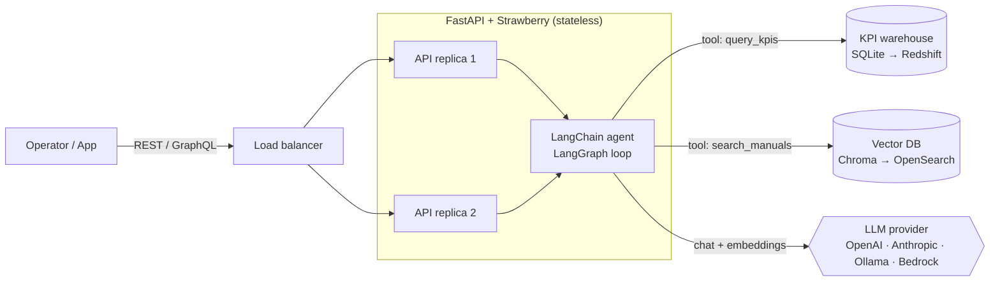

# Plant Ops Copilot — LLM agent for industrial operations

An AI assistant for the operators and supervisors of a biogas plant. It answers questions in natural language by
combining **live plant KPIs** (SQL tool over a data warehouse) with **operating procedures** (RAG over SOP manuals),
and exposes everything through **REST and GraphQL APIs**, ready to deploy on **AWS**.

> *"Which day had the worst temperature problem, how much electricity did we lose, and what does the procedure say?"*
> → the agent queries the KPI warehouse, searches the manuals, and answers with figures and cited sources.

## Architecture



| Requirement | Where it is in this repo |
|---|---|
| Python | Typed, tested code (`app/`), Pydantic contracts, async API |
| LLM-based systems | Agent with tools, memory, structured output (`app/agent.py`) |
| LangChain | `create_agent`, LCEL chains, retrievers, retries/fallbacks (`stages/s04`, `app/`) |
| REST / GraphQL APIs | FastAPI + Strawberry on the same business logic (`app/main.py`) |
| Distributed systems | Stateless replicas behind nginx, shared vector DB server, timeouts/retries (`docker-compose.yml`) |
| Prompt engineering | Versioned prompts, few-shot, guardrails, **automated eval set** (`app/prompts.py`, `eval/`) |
| Vector databases | Chroma with chunking, metadata and idempotent ingestion (`app/rag.py`) |
| AWS | Bedrock + ECR + ECS Express Mode (`infra/aws/DEPLOY.md`) |

## Quick start

```bash
python -m venv .venv && source .venv/bin/activate      # Windows: .venv\Scripts\activate
pip install -r requirements.txt
cp .env.example .env                                   # choose Ollama (free, local) or a cloud provider
pytest -q                                              # 12 tests, run offline with no API key
uvicorn app.main:app --reload                          # http://localhost:8000/docs  and  /graphql
```

### Example requests
```bash
curl -X POST localhost:8000/v1/ask -H "Content-Type: application/json" \
     -d '{"question": "How much biogas did we produce on 2026-10-19 and why was it low?"}'

curl -X POST localhost:8000/v1/incidents/classify -H "Content-Type: application/json" \
     -d '{"text": "Strong rotten egg smell near the gas holder, detector at 30 ppm"}'
```
```graphql
query { kpis(start: "2026-10-18", end: "2026-10-20") { fecha biogasNm3 estadoOperacion } }
mutation { ask(question: "What should I do if the boiler trips?") { answer toolsUsed sessionId } }
```

### Run as a small distributed system
```bash
docker compose up --build              # nginx :8080 -> 2 API replicas -> Chroma server
docker compose run --rm indexer        # (optional) re-index manuals into the shared vector DB
docker compose up --scale api=4        # horizontal scaling
```

## Design decisions
- **Provider-agnostic:** the model is chosen in `.env` (`init_chat_model`). No vendor lock-in; Bedrock for AWS.
- **The LLM never writes SQL:** `query_kpis` exposes a parameterised query over an allow-list of metrics.
- **Grounded answers:** the system prompt forces numbers to come from tools and procedures to be cited; out-of-scope
  questions must be answered with "I don't know" (checked by the eval set).
- **Structured output:** incident classification returns a validated Pydantic object, not free text.
- **Testable without an LLM:** a scripted model and hashing embeddings make the test suite deterministic and free.
- **Prompts are code:** versioned (`PROMPT_VERSION`) and regression-tested with `python -m eval.run_eval`.

## Project structure
```
app/            config, model factory, prompts, RAG, tools, agent, REST + GraphQL API
stages/         s01..s07 — step-by-step learning scripts (Python → LLM → prompting → LangChain → RAG → agent → API)
eval/           evaluation cases for prompts/agent
tests/          offline pytest suite
data/           SOP manuals (Markdown) + KPI warehouse (from the OT→IT data pipeline project)
infra/          nginx load balancer, AWS deployment guide
```

---
Data and manuals are simulated for demonstration purposes.
**Author:** Francisco Villa — Mechatronics Engineer, MSc Industry 4.0 Automation · [LinkedIn](https://linkedin.com/in/francisco-villa-632735152)
